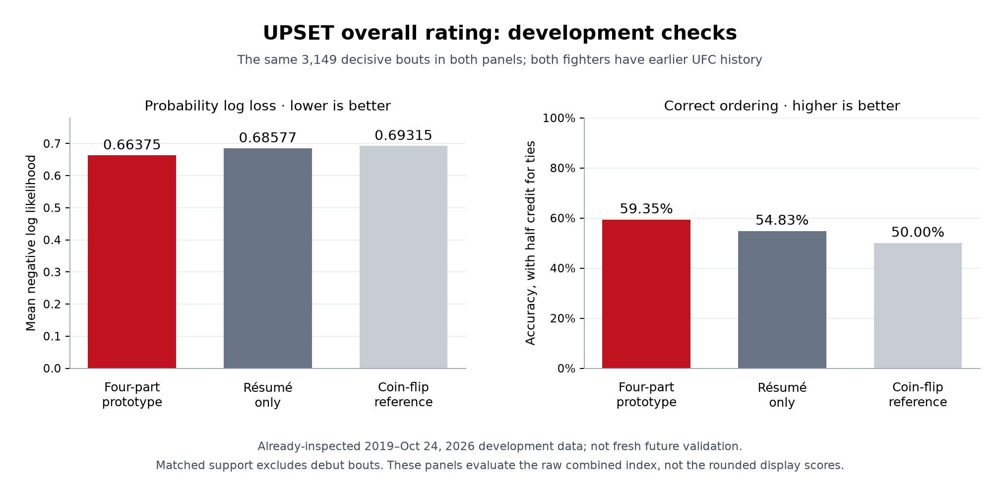

# Experimental UPSET rating — November 5, 2026

Real calculated **Experimental v1** ratings now feed the compact octagonal
badges on the local broadcast viewer. The same badge appears beside a portrait
on an individual profile and on each side of a matchup. The user-selected
colors remain red for 90–99, orange for 80–89, yellow for 70–79 and blue for
60–69. A click opens the four parts, their recent-weighted inputs, changes,
history and method.

This completes a working local numerical prototype. It does not complete
validation of individual latent skills, future predictive performance or a
public product release. No source data or old research result was overwritten.

## The number is calculated, not assigned by hand

The [declared protocol](OVERALL_RATING_PROTOCOL_V1.md) fixes rate priors,
recency, opponent-baseline residuals, context floors, component weights,
selection periods, display anchors and guardrails before the real build.

Striking, Wrestling and Grappling use different weighted performance features,
with missing inputs excluded rather than turned into zeros. Earlier opponents'
allowed/attack rates provide an experimental schedule adjustment. Résumé uses
chronological Elo. This is a residual-based research index; it is not a fitted
latent skill model or a reuse of the earlier failed opponent-defense model.

The skills blend is 50% of the strongest component, 30% of the second and 20%
of the third. Earlier chronological selection chose **25% Résumé + 75% Skills**
from the declared 25/50/75% résumé grid. This is the lower boundary of that
grid, not proof that 25% is a uniquely optimal weight. The original design's
50/50 split was a starting proposal. Component labels round to whole numbers;
all calculations keep full precision.

The overall is then graded separately against a **fixed historical UFC
reference through 2018**. It is not the average of the four displayed integers.
For example, Topuria's unrounded combined value is 88.4994, which lies at about
the 97.96th reference percentile (top 2.04%) and maps to 96. The conversion is
shown directly below the tiles. Individual components have not been inflated to make
them resemble the overall. They are indices, not measured division percentiles.

Fewer than five recorded UFC fights caps a score at 88; fewer than four marks
Provisional. Debuts have no number. After the first rating, one date-batch update
can change the displayed number by at most five points. These are explicit
product guardrails. Idle time, age and the L3/L5/L10 stat selector do not alter
the rating. Every snapshot lookup uses fights strictly before the page cutoff.

## A win and a rating increase are different calculations

A win increases the fighter's Elo and Résumé. The overall may still fall when
the skill contribution falls more. For Gaethje's latest recorded win, the parts
changed approximately:

| Part | Change in component index |
| --- | ---: |
| Striking | −0.78 |
| Wrestling | −1.34 |
| Grappling | −0.16 |
| Résumé | +1.09 |

His skills blend fell from 83.3323 to 82.5172 while Résumé rose from 88.5243 to
89.6161. At the 25/75 weights, the combined value fell from 84.6303 to 84.2919,
and the historical curve mapped 84 to 83.
Neither the limited-history cap nor the change cap caused this decline. The
latest result and part changes are exposed so this is not mistaken for a
penalty merely for winning. Topuria's June 14 entry is a loss in the reviewed
source data; the UI uses each fighter's actual result rather than assuming both
entries were wins.

The Résumé detail shows best wins ranked by the opponent's reconstructed grade
**strictly before that fight**, never the opponent's current grade or peak.
These are model-based strength comparisons, not official rankings. Grades for
pre-2019 history are retrospective under the frozen model, not ratings published
at that time. Recent-weighted model inputs and ordinary recorded statistics
are labelled separately.

## Historical development checks

Probability slopes were fitted on 2012–2015, the résumé/skills blend was selected
on 2016–2018, and the selected slope was then refitted on 2012–2018. The
2019–October 24, 2026 data have been examined in earlier research, so these are
**development results**, not a fresh
or protected future test. October 31 outcomes update the serving history but
were not used for this selection or evaluation.

On the same 3,149 eligible decisive bouts with earlier history on both sides:

| Measure | Combined rating index | Résumé-only reference | Chance reference |
| --- | ---: | ---: | ---: |
| Mean probability NLL, lower is better | 0.66375 | 0.68577 | 0.69315 |
| Brier, lower is better | 0.23570 | 0.24636 | 0.25000 |
| Winner ordering, half credit for ties | 59.35% | 54.83% | 50.00% |

The résumé-only reference uses the specified Elo-derived component with its
own earlier-fitted probability slope. This is not a claim to beat every Elo
formulation, published forecasting model or betting market.

The combined-minus-résumé NLL difference is −0.02202 per fight. The whole-date
bootstrap 95% interval is [−0.02798, −0.01616]; fighter-trajectory sensitivity is
[−0.02711, −0.01726], each with 1,000 replicates. Neither resolves all crossed
fight/fighter dependence or the full adaptive research process.

The user-facing **higher displayed rating** track record is a separate
calculation after integer grading and caps: 1,794 winners from 2,984 non-tied
rated comparisons, **60.1%**, with 165 ties and 709 debut/unavailable comparisons
excluded. It must not be confused with a 60.1% chance for an individual matchup.

The index did not improve every subgroup. Light Heavyweight and Women's
Flyweight have worse NLL than the résumé-only reference; the latter is also
worse than the chance NLL in this sample. Small divisions remain uncertain.
Fixed within-component weights, priors and proxy opponent adjustment still
need construct-validity and fresh future evaluation. No coefficients or grade
thresholds were retuned after inspecting hero names or these results.



## Reproducible saved snapshots and audit

The model read 8,866 accepted bouts and 17,732 statistical sides, and emitted
17,651 post-date states for 2,675 fighters with accepted fight history. Other
stored profiles remain unrated. All 4,469 source profiles and 89 previously
excluded bouts retain their earlier data status.

Artifacts are in `data/processed/overall_rating_2026_11_05_v1/`: configuration,
protocol, source/database hashes, full pre-fight features, dated `ratings.jsonl`,
fitted choices/reference values, development records, assessment and manifest.
November 5's study outputs are byte-identical to November 4's; only snapshot
cutoff/provenance differs because no new recorded bouts were acquired.

The independent audit reconstructed source inputs and verified 300,067 weighted
input values, 70,604 component formulas, 17,651 grade/cap/peak calculations,
6,298 logistic scores and 6,298 historical serving lookups. The extra real-data
chronology check removed 1,430 later bouts: 7,436 earlier pre-fight records,
14,791 earlier graded states and 9,767 reference values remained **exactly**
unchanged, without refitting parameters.

Audit outputs:

- `data/processed/overall_rating_verification_2026_11_05.json`
- `data/processed/overall_rating_prefix_verification_2026_11_05.json`

The old protection baseline has 388 files: 386 remain byte-identical, while the
two authorized viewer source files changed. The 17,708-side frozen defense seed,
its dependencies, earlier striking studies, portraits and serving database
remain intact. Snapshots verify all model/input/output hashes before startup.
Requests perform indexed lookup and explanatory arithmetic, not model fitting.

Across the model, adapter, serving and viewer checks, 317 Python tests passed,
along with all three JavaScript UI suites, Ruff and whitespace checks. The live
browser verified the portrait badges, unchanged scores when switching stat
windows, fight history chips, whole-number tiles, the visible conversion and
the Résumé pre-fight grades. The 390px phone dialog fits without horizontal
scrolling, with the conversion visible below the tiles and “OUT OF 99” below
the octagon. The method remains available through the information button.

Screenshots: [matchup](assets/overall_rating_2026_11_05_v1/comparison.jpg),
[profile](assets/overall_rating_2026_11_05_v1/profile.jpg),
[Topuria breakdown](assets/overall_rating_2026_11_05_v1/breakdown-topuria.jpg),
[phone breakdown](assets/overall_rating_2026_11_05_v1/breakdown-phone.jpg).

## Start UPSET after a shutdown

Double-click **Start UPSET.command** in this checkout, or run:

```bash
cd /Users/ayaanahmed/Projects/upset
./"Start UPSET.command"
```

The launcher reuses verified snapshots for the Chicago calendar date. If the
date has changed, it creates new dated snapshots from the existing database;
it does not download fight cards, overwrite old snapshots or reset research.
Leave its Terminal window running. Ctrl+C stops the foreground server. It
refuses to start a second server if port 8768 is occupied.

To start the exact delivered snapshot manually:

```bash
cd /Users/ayaanahmed/Projects/upset
.venv/bin/python -m upset.research_app \
  --database data/processed/research_2026_11_03_v1/upset.sqlite \
  --design broadcast --roster data/roster/roster.json \
  --striking-preview data/processed/experimental_striking_preview_2026_11_05_v1 \
  --rating-snapshot data/processed/overall_rating_2026_11_05_v1 \
  --port 8768
```

Open <http://127.0.0.1:8768>. Reload an existing browser tab to load the new
interface. The exact November 5 snapshot supports cutoffs through November 5;
use the launcher for a later day rather than removing future-cutoff checks.

To stop a background server, inspect `lsof -nP -iTCP:8768 -sTCP:LISTEN`, verify
its numeric PID with `ps -p PID -o command=`, and only if it is this UPSET
server use `kill -INT PID`. Never terminate another process merely to claim
the port. The old flags remain available: omitting `--rating-snapshot` returns
the explicit unrated state; omitting `--striking-preview` hides that separate
mean estimate. Existing raw statistics remain available in both cases.

If the Python environment must be recreated: `python3.12 -m venv .venv`, then
`.venv/bin/python -m pip install -e '.[dev]'`. Changed model sources or database
hashes deliberately invalidate a bound snapshot; create and audit a separate
new snapshot rather than editing its manifest.
