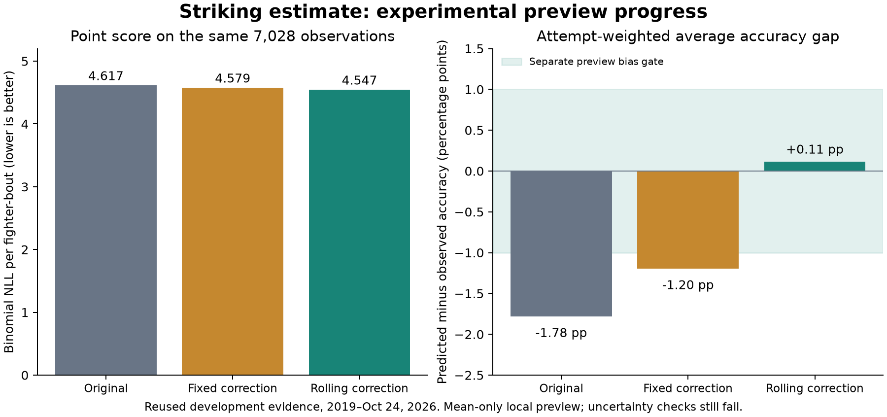

# Experimental striking preview — November 4, 2026

UPSET now has a working experimental significant-strike accuracy estimate on
the local broadcast site at <http://127.0.0.1:8768>. Open a fighter and select
**Career**. The new card compares a recent-weighted estimate with recorded
career accuracy. Existing recorded statistics retain their original values.
The preview is optional and local; no public deployment occurred.

## What improved, and what still failed

All comparisons below use the same 7,028 historical fighter-bout observations
on 333 dates from 2019 through October 24, 2026. Lower point NLL is better.
The accuracy gap is attempt-weighted predicted minus observed accuracy.

| Mean estimate | Point NLL | Accuracy gap | Separate preview gate |
| --- | ---: | ---: | --- |
| Original sample-adjusted mean | 4.61724 | −1.78 percentage points | Reference |
| Recent-weighted mean with fixed correction | 4.57903 | −1.20 percentage points | Failed |
| Recent-weighted mean with rolling correction | 4.54692 | +0.11 percentage points | Passed |

The fixed-correction study missed the declared maximum absolute bias of one
percentage point. Its artifacts remain saved as a failed attempt. A subsequent
[rolling-calibration protocol](STRIKING_ROLLING_CALIBRATION_PROTOCOL_V1.md)
was declared before running that separate study. Its point-score improvement
versus the original is −0.07031 NLL per observation, with a whole-date bootstrap
95% interval of [−0.10671, −0.03628]. No sufficiently sized subgroup triggers
the declared material point-regression rule. This does not mean every group
improves or that individual estimates are accurate to 0.11 percentage points.

**Uncertainty validation still fails.** The rolling study flags 24 overlapping
subgroup labels, versus 17 in the retained fixed-correction repair and 11 in
the original validation. These are diagnostic flags, not disjoint observations.
The rolling point improvement does not establish improved uncertainty. The
local card therefore serves only the estimated mean. Skill intervals, rankings,
opponent adjustment and winner forecasts remain unfinished.

These are subsequent development studies using previously inspected historical
data. The bootstrap intervals do not account for the entire adaptive research
process. This is not fresh holdout evidence, protected prospective validation,
or authorization for a validated skill release. Both reports explicitly retain
`public_release=false` and `opponent_adjusted=false`.



## How the preview works

The base mean weights earlier bouts with an exponential 2,920-day half-life and
shrinks toward the corresponding population history using prior strength 500.
Both values were selected on 2012–2015 data; the half-life is the upper tested
grid boundary. This is a development choice, not an established biological
timescale. The later correction uses only earlier available observations in
the preceding 730 days. Same-day outcomes never enter the estimates for that
day. Correction values are computed offline; requests perform lookup and
weighted-history arithmetic, with no model fitting.

The serving snapshot uses the reviewed database through October 31: 4,469
profiles, 8,866 bouts and 17,732 fighter-stat rows. October 31 outcomes did not
select or score the research studies; they enter only later serving histories
and calibration values after their event date. The 89 previously excluded
bouts remain excluded, and the 298 portrait assets are preserved. The featured
Waldo Cortes Acosta–Johnny Walker matchup is unchanged by this preview.

The snapshot supports daily cutoffs from January 1, 2019 through November 4,
2026, inclusive, with fights strictly before the selected date. A later date
shows an unavailable message until a new snapshot is built. To inspect this
snapshot on a later day, choose November 4, 2026 in the date control. L3/L5/L10
show a request to select Career. Fighters without positive linked attempt
history receive an unavailable message rather than a fabricated estimate.

The snapshot is bound to the passing report, selected model, source and serving
database hashes. Startup rejects changed inputs. It is not portable to a
different database or moved repository without creating a new bound snapshot.

## Run it again

The preview server is already running on port 8768. Visit
<http://127.0.0.1:8768>, open a fighter and select Career. Do not start a second
server on the same port while it is running.

For a later restart, run this in Terminal from the existing checkout:

```bash
cd /Users/ayaanahmed/Projects/upset
.venv/bin/python -m upset.research_app \
  --database data/processed/research_2026_11_03_v1/upset.sqlite \
  --design broadcast \
  --roster data/roster/roster.json \
  --striking-preview data/processed/experimental_striking_preview_2026_11_04_v1 \
  --port 8768
```

Leave Terminal running. Ctrl+C stops a foreground server. For the background
server started during this update, find its process first:

```bash
lsof -nP -iTCP:8768 -sTCP:LISTEN
```

Read the PID column, then run `ps -p PID -o command=` with that numeric PID.
Only if it identifies this `upset.research_app` server on port 8768, stop it
with `kill -INT PID`. Then run the start command above. The original command,
backup source files and startup log are under
`backups/experimental-striking-preview-20261104-v1/`.

To run recorded statistics without the experimental feature, omit the entire
`--striking-preview ...` line. Port 8767 was left running without that flag.
If 8768 is occupied and you want an additional viewer, change `--port` and
visit that port instead.

The existing Python 3.12 virtual environment is installed. If it must be
recreated, run `python3.12 -m venv .venv`, then
`.venv/bin/python -m pip install -e '.[dev]'` before starting the app.

## Research reproduction and checks

The retained studies are in
`data/processed/striking_adaptation_2026_11_04_v1/` and
`data/processed/striking_rolling_2026_11_04_v1/`. They contain protocol/config,
source and input hashes, predictions, score records, diagnostics and decisions.
Their modules expose `--help`; reproduce into new output folders, never over
the retained artifacts. The original
[adaptation protocol](STRIKING_ADAPTATION_PROTOCOL_V1.md) records selection
splits, grids, diagnostic bands and the separate preview gate.

To build another serving snapshot from the passing study, use a **new** output
directory. For the existing database and date, the command is:

```bash
cd /Users/ayaanahmed/Projects/upset
.venv/bin/python -m upset.skill.striking_preview \
  --study data/processed/striking_rolling_2026_11_04_v1 \
  --database data/processed/research_2026_11_03_v1/upset.sqlite \
  --registry data/processed/cito_current_2026_11_03_reviewed_v1/fighter_registry.json \
  --before 2026-11-04 \
  --output data/processed/experimental_striking_preview_2026_11_04_v2
```

For a later cutoff or database refresh, rebuild a separate snapshot with the
matching reviewed database and registry, verify chronology/parity, then change
the app flag to the new snapshot. This command does not acquire new card data.

Verification completed for this delivery:

- 196 striking and frozen-defense tests passed; 30 viewer/data regression
  tests passed. Ruff and both JavaScript UI check suites passed.
- Independent log-beta/log-gamma arithmetic verified all 77,308 saved repair
  scores and 704 enumerated predictive distributions. Maximum score difference
  was below 7×10⁻¹³.
- All 7,028 historical serving estimates match the rolling research estimates;
  maximum difference is below 5×10⁻¹⁵. Current and historical HTTP responses,
  unsupported dates and non-career windows were checked.
- A real browser reload visibly confirmed Justin Gaethje's new card: 54.8%
  experimental estimate beside 57.6% recorded career accuracy. His raw report
  remains identical after removing the added optional preview field.
- 370 of 372 preservation-baseline files are byte-identical. The only changes
  are the authorized optional API integration and broadcast page; both original
  files are backed up and match their baseline hashes. All prior research,
  serving databases, portraits and the 17,708-side frozen defense seed remain
  intact.

The machine-readable audit is
`data/processed/striking_preview_verification_2026_11_04.json`, with its source
in `scripts/verify_striking_preview.py`. It intentionally uses an exclusive
output file; preserve that result if rerunning the audit. The standalone PNG
and PDF figure are in `docs/assets/striking_preview_2026_11_04_v1/`.

The next research milestone is a separately declared study of the remaining
attempt-volume and subgroup uncertainty failures, followed by protected future
evaluation. The local mean preview can be used while that work continues.
