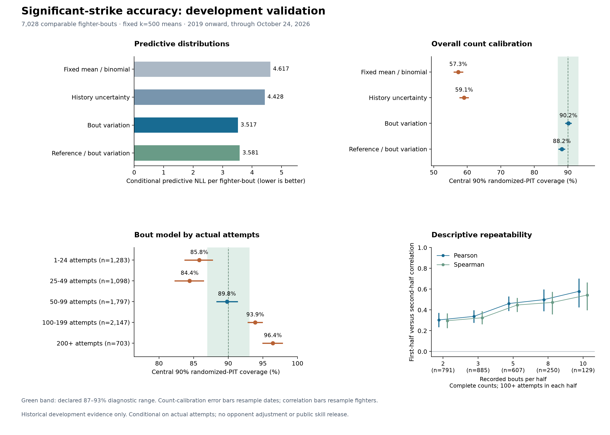

# Striking accuracy validation — November 4, 2026

**The full declared validation milestone is complete. The candidate remains an
offline research reference; the website keeps its raw statistics.**

The fixed accuracy mean still improves historical point scores. Adding variation
between bouts greatly improves overall count uncertainty. However, a single
bout-variation parameter misses the declared calibration bands in several
important subgroups, and the mean still underpredicts overall landed accuracy.
This is not a public skill-release pass.



[Download the figure as PDF](assets/striking_validation_2026_11_04_v1/validation_summary.pdf).

## What was held fixed and checked

[The protocol](STRIKING_VALIDATION_PROTOCOL_V1.md) was saved before calculating
new validation results. All 17,708 original v1 predictions reproduced exactly,
and an independent reconstruction of pre-date integer histories agreed. The
dataset ends October 24, with an exclusive October 26 cutoff. October 31 outcomes
from the newer serving database were not used.

The mean-strength parameter stays k=500, at the upper edge of the original grid.
No wider mean-strength search or development-driven repair was performed. The
five simple references were compared on 5,279 tuning sides from 2012–2018;
the earlier population mean was selected. Candidate and population-only bout
concentrations were tuned independently on that same tuning population over
{2,5,10,20,50,100,200,500,1000}. Both selected c=20, inside the grid. The complete
score curves and selections are saved in the report. No defense parameter was
used to select either value.

The primary development comparison retains the exact 7,028 v1 comparable sides,
672,393 actual attempts and 333 calendar dates. There are 1,257 distinct fighters
in this primary population. Other populations remain separate: 5,370 established
sides, 7,845 broader positive-trial sides and 817 cold starts. Current zero-attempt
bouts remain in histories and coverage counts, with no fabricated accuracy.

## Point estimates and predictive uncertainty

All 11 predictive distributions use the same primary observations. The table
below highlights the candidate and the selected reference. NLL is conditional
predictive negative log likelihood per fighter-bout; lower is better. PIT values
are central coverage after randomizing the position within the observed integer
count's probability mass, using the primary declared seed.

| Distribution | NLL / side | Central 50% PIT coverage | Central 90% PIT coverage |
| --- | ---: | ---: | ---: |
| Candidate mean, plug-in binomial | 4.61724 | 26.31% | 57.33% |
| Candidate, stationary-history beta-binomial | 4.42775 | 27.29% | 59.06% |
| Candidate, bout-varying beta-binomial (c=20) | 3.51699 | 52.28% | 90.15% |
| Earlier population mean, bout-varying beta-binomial (c=20) | 3.58126 | 48.99% | 88.19% |

The candidate bout model's overall 50% and 90% checks lie within the declared
45–55% and 87–93% bands for all three randomization seeds. For the primary seed,
the date-bootstrap 95% ranges are 51.05–53.51% and 89.33–90.91%, respectively.
Its average Pearson dispersion is 0.990; the plug-in binomial's is 4.628 and the
stationary-history version's is 4.168. These are descriptive dispersion checks,
not chi-square tests.

Candidate-minus-reference predictive NLL differences, with whole-date 95% ranges:

- Versus the candidate plug-in binomial: −1.10025 [−1.17863, −1.02496].
- Versus stationary-history uncertainty: −0.91076 [−0.97705, −0.84595].
- Versus the population mean with its independently tuned bout variation:
  −0.06427 [−0.07266, −0.05701].

The frozen candidate's binomial point score remains better than the selected
population-only reference: −0.35810 NLL/side [−0.40863, −0.30727]. Fighter-trajectory
bootstrap sensitivity also has an upper endpoint below zero for these primary
comparisons. Date resampling retains shared bouts; fighter resampling retains
trajectories across dates. Neither one-way procedure jointly resolves both forms
of dependence, so neither is treated as a confirmatory release test.

Integer predictive ranges are kept distinct from PIT diagnostics. The candidate's
nominal 90% integer range covers 92.12% of outcomes, with an average expected mass
of 91.77%. Its nominal 50% range covers 57.41%, versus expected mass 55.57%.
Discreteness alone can make integer ranges exceed the nominal label; the report
therefore includes their actual mass, width, PIT histogram and seed sensitivity.

**A remaining mean-bias finding:** observed attempt-weighted accuracy is 46.99%,
versus predicted 45.21%, a 1.78 percentage-point gap. Mean count error is +1.707
landed strikes per side, with a date-bootstrap range of +1.299 to +2.124.
Reasonable overall dispersion and central PIT coverage do not establish an
unbiased conditional mean. No recalibration was fitted after seeing this result.

## Subgroups expose failures hidden by the overall average

The study reports 40 overlapping groups covering year, era, division, source,
prior exposure, prior bouts, actual attempts and duration. No sufficiently sized
group triggers the declared material *point-score* regression rule against the
selected simple reference. That does not mean its predictive uncertainty passes.

| Actual significant-strike attempts | Sides | Central 90% PIT coverage | Both levels, all seeds |
| --- | ---: | ---: | --- |
| 1–24 | 1,283 | 85.81% | Outside bands |
| 25–49 | 1,098 | 84.43% | Outside bands |
| 50–99 | 1,797 | 89.82% | Within bands |
| 100–199 | 2,147 | 93.90% | Outside bands |
| 200+ | 703 | 96.44% | Outside bands |

The fixed-concentration distribution is too narrow for the low-attempt groups
and too broad for high-attempt groups. These are conditional-on-observed-attempts
findings, not predictions of how many attempts a future fight will contain.

Eleven group labels fail at least one 50%/90% check across the declared seeds:
four actual-attempt groups above; Welterweight and unclassified division;
durations below 60 seconds, 60–299 seconds and 900+ seconds; prior attempts 1–99;
and year 2025. Borderline seed failures remain visible: for example, the 25–49
group's primary 50% PIT coverage is 46.08%, but a sensitivity seed gives 44.90%.
Women's Featherweight has only 36 sides and is explicitly inconclusive even
though it spans 20 dates. Overlapping group diagnostics are not independent,
and no multiplicity-adjusted significance or universal release threshold is
claimed.

The broader candidate population and cold starts are secondary analyses, not
substitutes for paired support. Their primary-seed 90% PIT coverage is 89.88%
and 87.52%, respectively. Both meet the overall declared central bands across
all seeds, while narrower conditional subgroups can still fail.

## Repeatability across disjoint career portions

The history universe contains 2,670 fighters with recorded bouts. Each analysis
uses a fighter's first M and next M recorded bouts, complete selected counts,
separate calendar dates at both boundaries, and at least 100 attempts in each
half. Missing/invalid observations are excluded rather than silently skipped;
true zero-attempt bouts consume slots. Exact selected bout IDs and attrition
are retained in the artifacts.

| Bouts in each half | Eligible fighters | Pearson correlation [95% range] | Spearman correlation |
| --- | ---: | ---: | ---: |
| 2 | 791 | 0.304 [0.239, 0.365] | 0.296 |
| 3 | 885 | 0.338 [0.280, 0.392] | 0.325 |
| 5 | 607 | 0.461 [0.394, 0.525] | 0.448 |
| 8 | 250 | 0.499 [0.392, 0.591] | 0.472 |
| 10 | 129 | 0.579 [0.429, 0.697] | 0.543 |

All listed correlations have 1,000 defined fighter-bootstrap replicates. The
secondary complete-count positive-exposure population and sufficiently sized
stable-division slices are also reported. The 3-bout group can contain more
fighters than the 2-bout group because it is easier to reach the fixed 100-attempt
minimum in a longer half. At 10 bouts per half, 2,541 fighters lack the required
20 recorded bouts. Different rows describe different survivor populations;
their upward correlation pattern is not a causal effect of adding fights or
proof that a chosen number of fights makes skill reliable. No minimum-history
release threshold was selected.

## Verification and artifacts

- 171 relevant tests passed, including 32 new validation tests and the earlier
  striking/defense suites. Targeted Ruff and Git whitespace checks passed.
- Matching-model simulations covered 8,000 stationary fighters and 8,000
  bout-varying observations. Stationary 90% latent-rate coverage was 89.58%,
  PIT coverage 89.29%, and mean bias −0.00049. The separate bout simulation
  recovered its true grid concentration 20 with PIT coverage 90.05%. These
  verify numerical behavior under known generators, not real MMA assumptions.
- An independent formula audit checked all 77,308 saved predictive log scores;
  maximum absolute error was 6.83e−13. Complete PMF enumeration independently
  checked 704 selected distributions and their quantiles/range masses.
- All 3,727 saved repeatability pairs were audited against the original adapter
  for exact prefix windows, counts, disjoint bout IDs and complete-date boundaries.
- All 363 preservation hashes match. The source/site, both serving databases,
  portraits, registry, original striking study and frozen defense dependencies
  and seed remain unchanged. No model or result was added to the UI.

Implementation:
`src/upset/skill/striking_validation.py`, `src/upset/skill/striking_repeatability.py`,
`tests/test_striking_validation.py`, `scripts/verify_striking_validation.py`, and
`scripts/plot_striking_validation.py`.

Saved research output: `data/processed/striking_validation_2026_11_04_v1/` contains
`report.json`, `config.json`, `protocol.md`, all original `predictions.jsonl`,
`calibration_rows.jsonl` for the matched comparison, and
`repeatability_pairs.jsonl`. Hashes and runtime versions are recorded.
The independent verification is
`data/processed/striking_validation_verification_2026_11_04.json`; the preservation
baseline is `data/processed/striking_validation_start_2026_11_04.json`.

## Decision and next work

Retain k=500 as a fixed offline research reference, reject stationary-history
uncertainty as an adequate count-distribution description, and retain the c=20
bout-variation result as a useful but incomplete development baseline. **Keep
raw statistics on the website.** Overall calibration does not override the
actual-attempt/duration subgroup failures or the observed mean bias.

The next separately declared research study should examine exposure-dependent
dispersion and chronological mean drift/calibration, without rewriting this
study or treating these inspected years as untouched data. Opponent adjustment,
validated latent-skill intervals, protected future evidence and versioned
serving snapshots/windows remain required before public skill estimates.
The frozen defense evaluation continues independently.

## Reproduce with new output names

```bash
cd /Users/ayaanahmed/Projects/upset
.venv/bin/python -m pytest -q tests/test_striking_validation.py tests/test_striking_skill.py
.venv/bin/python -m upset.skill.striking_validation \
  --adapter data/processed/striking_adapter_2026_11_03_v1 \
  --prototype data/processed/striking_accuracy_2026_11_03_v1 \
  --output data/processed/striking_validation_2026_11_04_recheck
.venv/bin/python scripts/verify_striking_validation.py \
  --validation data/processed/striking_validation_2026_11_04_recheck \
  --adapter data/processed/striking_adapter_2026_11_03_v1 \
  --baseline data/processed/striking_validation_start_2026_11_04.json \
  --defense-freeze data/processed/td_defense_prospective_freeze_2026_10_26_v1 \
  --output data/processed/striking_validation_recheck_audit.json
```

Existing artifacts refuse overwrites. No provider requests, account changes,
winner-model fitting, automation, Git commit or push was performed.
