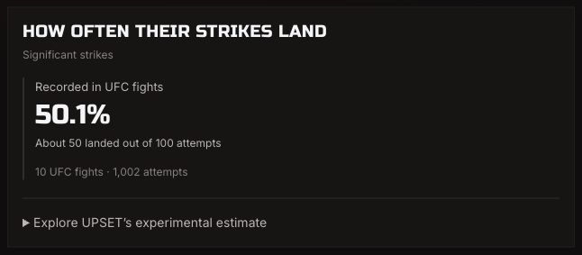
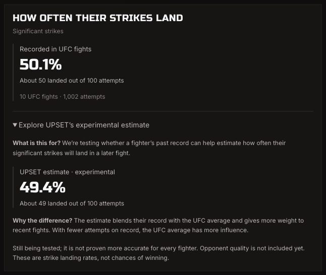

# Plain-language striking card

Recorded significant-strike accuracy already exists: landed divided by attempted
strikes in the accepted UFC history. No model is needed to calculate it.

The separate experiment tests whether earlier fight history can provide a
useful estimate for a later fight. It blends a fighter's earlier counts with a
population prior, weights recent history more, and uses a chronological
calibration correction. It adds assumptions rather than new observed strikes.
Limited attempts can produce a large difference between the recorded rate and
the estimate because the population prior has substantial influence.

Potential value is a less volatile historical estimate and a feature for later
analytics, if validation supports those uses. Current development results show
only modest improvement in individual realized-fight error. This does not
establish that the estimate is better for every fighter, account for opponent
quality, or supply a winner prediction. See the
[individual-error audit](STRIKING_POINT_ERRORS_2026_11_04.md).

The broadcast page now:

- Uses **How often their strikes land**, with the tracked category identified
  as significant strikes.
- Shows **Recorded in UFC fights** first, retaining its exact percentage and
  observed fight/attempt counts, followed by an approximate plain-language
  translation such as “About 58 landed out of 100 attempts.”
- Keeps research behind **Explore UPSET’s experimental estimate**, collapsed
  by default. It explains the research purpose, shows the estimate and its
  translation, and explains the influence of the UFC average and recent fights.
- States that it is still being tested, has not been proven more accurate for
  every fighter, does not include opponent quality and is not a win probability.

This is a presentation change only. The model, gate, serving snapshot, date
contract and raw statistics are unchanged. The server serves the HTML from
disk, so reloading the page applies the change without a server restart.

Both JavaScript UI check suites and whitespace checks pass. Existing preview
checks now verify the simpler language, recorded-first ordering and default
collapsed research state. Real-browser checks confirmed the collapsed and
expanded content on the running local viewer. Screenshots are in
`docs/assets/striking_plain_language_2026_11_04/`. Verified original files and
a delivery record are in `backups/striking-plain-language-20261104-v1/`.

