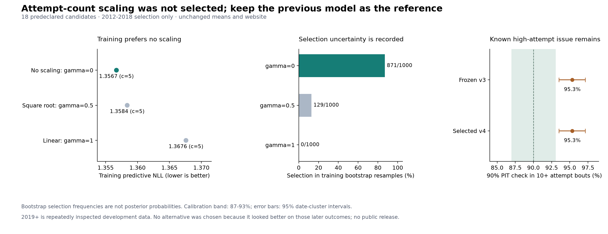

# Attempt-count scaling study, October 26, 2026

**Result: retain the v3 constant-concentration reference.** Training-only
selection chose c=5, gamma=0: exactly the previous model. The declared scaling
alternatives did not improve the selection objective. We did not override that
choice using the already inspected later outcomes.

The high-attempt calibration issue is therefore still open. The site remains
raw, rankings remain removed, and no opponent-adjusted or uncertainty feature
was released.



## Hypothesis and fixed comparison

The v3 beta-binomial model uses one concentration, kappa=5, so its conditional
count variance grows quadratically with the number of opposing attempts.
This study tested kappa(n)=c*(max(n,1)/5)^gamma, while keeping every fighter's
estimated defense mean fixed. gamma=0 recovers v3; gamma=1 gives approximately
linear high-attempt count variance. c is concentration at five attempts, not
fighter prior exposure or a measured within-bout correlation.

The protocol was written before scoring the alternatives:
`docs/TAKEDOWN_DEFENSE_ATTEMPT_SCALING_PROTOCOL_V4.md`. The 18 declared candidates
used c in {2,5,10,20,50,100} and gamma in {0,0.5,1}. Selection used only the
unchanged 3,288 comparable 2012-2018 side-bouts, across 265 dates. Of these,
2,461 had n>=2 and could inform concentration. No candidate was selected by
2019+ interval coverage.

## Training did not select attempt scaling

| Exponent | Best anchor concentration | Mean training predictive NLL |
| --- | ---: | ---: |
| 0, no scaling | 5 | **1.35670** |
| 0.5, square-root concentration | 5 | 1.35838 |
| 1, linear concentration | 5 | 1.36759 |

Lower is better. The square-root candidate's difference from v3 is +0.00169;
the linear candidate's difference is +0.01089. The lowest-scoring declared
candidate is the existing constant-concentration model. This is evidence about
this grid and objective, not proof that variance can never depend on attempts.

In 1,000 whole-training-date bootstrap resamples, selection was:

- c=5, gamma=0: 765 resamples.
- c=10, gamma=0: 106 resamples.
- c=5, gamma=0.5: 129 resamples.
- All other pairs: zero resamples.

Thus no scaling was selected in 87.1% of resamples, and square-root scaling in
12.9%. These are resampling selection frequencies, not posterior model
probabilities. The small training difference means uncertainty in selection is
worth retaining. The selected c is not a concentration-grid edge; gamma=0 is
the simple-model boundary.

## Later results are unchanged, not a new gain

Because selection returned v3 exactly, the new model's scores and predictions
match that reference on the 4,197-side / 333-date primary development cohort:

| Quantity | Selected v4 / frozen v3 |
| --- | ---: |
| Mean predictive NLL | 1.35365 |
| Mean normalized RPS | 0.17273 |
| Overall nominal 50% PIT check | 52.30% |
| Overall nominal 90% PIT check | 90.92% |
| 10+ attempt nominal 50% PIT check | 57.43% |
| 10+ attempt nominal 90% PIT check | 95.34% |

The paired v4-minus-v3 score and interval-score differences are zero. There is
no predictive-score or interval-score evidence beyond v3. Improvement over the
older binomial/posterior references is preserved but is not a new achievement
of attempt scaling.

Overall diagnostics remain inside the 45-55% and 87-93% bands. The 10+ attempt
90% check remains above band, with a 95% date-cluster interval of
[93.50%,97.12%]. Nine overlapping slice-by-level diagnostics still miss their
bands; two small division slices remain inconclusive. Their full details,
randomization sensitivity, integer-interval expected masses, widths, interval
scores and proper-score comparisons are retained in the JSON report and
explained in the v3 report. The discrete-adjusted PIT percentages are not
literal coverage percentages for an underlying fighter skill.

The established-history, broader positive-trial and cold-start populations
were kept separate. No easier rows were added to just one candidate's primary
comparison. Zero-attempt observations remain unavailable for rate calibration.
No fighter mean, frozen winner model, source statistic, or database changed.

## Numerical checks and preservation

A matching-model simulation used 8,000 independent bouts with known c=5,
gamma=1: 4,000 for the same selection procedure, 4,000 for synthetic validation.
It recovered the correct grid pair and passed the predeclared mean/variance
and 50%/90% predictive calibration checks. This demonstrates that the procedure
can detect scaling under these known assumptions; it does not establish that
real UFC outcomes satisfy them.

All 17,708 v3 prediction records reproduced exactly before the study. New output
rows preserve all original fields and append the selected scaling parameters,
conditional beta shapes, count means and count variances. They do not fabricate
new source measurements or construct fighter skill intervals.

50 relevant tests passed, including exact gamma=0 reproduction, the five-attempt
anchor, the high-n variance limit, n=1 concentration invariance, future-independent
selection, numerical ties, finite predictions and matching-model recovery.
Ruff and `git diff --check` passed. Independent PMF/CDF/moment/RPS checks and
unchanged original-file/database hashes are recorded in the verification JSON.
No package installation, data acquisition, server restart, commit or push was
performed.

## Artifacts and reproduction

- Protocol: `docs/TAKEDOWN_DEFENSE_ATTEMPT_SCALING_PROTOCOL_V4.md`.
- Code: `src/upset/skill/defense_attempt_scaling.py`.
- Full study: `data/processed/td_defense_attempt_scaling_2026_10_26_v4/report.json`.
- Extended rows: `data/processed/td_defense_attempt_scaling_2026_10_26_v4/predictions.jsonl`.
- Verification: `data/processed/td_defense_attempt_scaling_verification_2026_10_26.json`.
- Figure generator: `scripts/plot_defense_attempt_scaling.py`.

Existing outputs are immutable. Use a new output name to reproduce:

```bash
cd ~/Projects/upset
source .venv/bin/activate
python -m upset.skill.defense_attempt_scaling \
  --adapter data/processed/td_defense_adapter_2026_10_26_v1 \
  --variability data/processed/td_defense_variability_2026_10_26_v3 \
  --protocol docs/TAKEDOWN_DEFENSE_ATTEMPT_SCALING_PROTOCOL_V4.md \
  --output data/processed/<new-attempt-scaling-directory>
```

## What follows

Further tuning just to fix the inspected 2019+ slice would weaken the evidence.
The next distinct hypothesis is opponent quality: whether a defender's results
can be explained better by separating their defense from their opponents'
takedown attack. That effect has not been demonstrated. A bounded first-model
specification is prepared in `docs/TAKEDOWN_DEFENSE_OPPONENT_MODEL_SPEC_V1.md`;
no opponent model was fitted during this study.

The existing global mean / v3 variability model stays the reference. Opponent
adjustment, mean/hyperparameter uncertainty, protected future evaluation and
remaining release gates are still open. Both public_release and
opponent_adjusted remain false.
