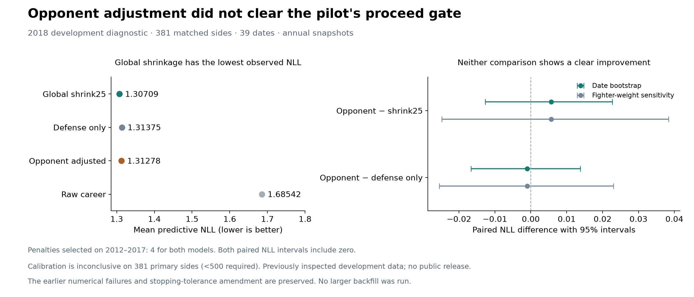

# Chronological opponent pilot — October 26, 2026

**Result: retain the global shrink25 reference.** Opponent adjustment did not
clear the declared gate for a larger event-updated backfill. Its 2018 primary
NLL and RPS were slightly worse than global shrinkage. Its small improvement
over a context-matched defense-only fit was uncertain under both dependence
checks. No larger backfill or public feature was released.



## Fixed design and selection

All models used the same annual snapshots. Each January 1 fit used strictly
earlier positive-count adapter observations and predicted the next calendar
year without within-year updates. Concentration remained 5 for every
beta-binomial predictive distribution. This predicts stopped counts conditional
on actual attempts, not future opportunities, victories or latent skill.

The primary support required two earlier positive-attempt defender bouts.
Penalty selection used 1,925 matched sides across 2012-2017. Both model families
selected penalty 4 from the declared {1,4,16} grid, before any 2018 score was
computed. The complete per-year table is preserved in report.json.

| Role penalty | Defense-only training NLL | Attack/defense training NLL |
| --- | ---: | ---: |
| 1 | 1.37860 | 1.38250 |
| 4 | **1.36669** | **1.36518** |
| 16 | 1.38167 | 1.37962 |

The raw and global-shrink means also used the same annual histories. These
scores should not be compared directly with earlier event-updated studies:
their periods, support and update cadence differ. Previously inspected years,
including 2018, remain development data. Nothing here is protected validation.

## Frozen 2018 diagnostic

The primary cohort contained 381 sides, 1,599 attempts and 39 dates. All four
models were scored on exactly these observations.

| Model | Predictive NLL | Normalized RPS |
| --- | ---: | ---: |
| Raw career | 1.68542 | 0.19377 |
| Global shrink25 | **1.30709** | **0.17222** |
| Defense-only | 1.31375 | 0.17354 |
| Opponent adjusted | 1.31278 | 0.17290 |

Lower is better. Opponent-minus-reference NLL differences were:

| Reference | Mean difference | Date-bootstrap 95% interval | Fighter-weight sensitivity 95% interval |
| --- | ---: | --- | --- |
| Global shrink25 | +0.00568 | [-0.01270, +0.02275] | [-0.02480, +0.03840] |
| Defense-only | -0.00098 | [-0.01666, +0.01382] | [-0.02548, +0.02307] |

Neither contrast had an upper interval below zero under either scheme.
Opponent RPS was +0.00068 worse than shrink25 and -0.00064 better than
defense-only. This fails six declared proceed conditions: shrink25 NLL
improvement, shrink25 RPS nonworsening, and upper NLL bounds below zero against
both references under both schemes. No sized subgroup triggered the additional
material NLL regression rule, but many slices were too small to assess.

These intervals describe the fixed predictions, excluding re-selection or
refitting uncertainty. The fighter-weight calculation probes repeated-fighter
dependence and is not a universally valid confidence interval. An uncertain
negative result for this pilot does not show that opponent quality never matters.

## Calibration, newcomers and limitations

Opponent randomized PIT checks were 50.39% and 91.86% at the nominal 50% and 90%
levels. **Overall calibration is inconclusive** because 381 sides is below
the declared minimum 500; values inside a band do not override that rule.
Integer 90% count ranges covered 99.21%, with expected discrete mass 98.95%.
That is not evidence of 99% coverage for an underlying fighter skill.

The 10+ attempt slice had only 39 sides. It cannot resolve the earlier
high-attempt uncertainty problem. All 12 division slices were also thin.
Primary schedule comparisons included 309 within-component, 18
across-component and 54 unseen-attacker-role sides. The latter two were thin.
Division and era effects are still omitted, and annual snapshots become stale
within the year. These are limits of this specific candidate and experiment.

Separate reports retain all 622 positive-count 2018 sides, 166 defender cold
starts and 144 attacker cold starts. Raw career is absent for zero defender
history; no rate was invented. Across the seven evaluated years, raw career
needed endpoint clipping for 123 primary / 425 available positive-side means.
Zero-attempt and other excluded measurements remain audited, not imputed.

## Numerical amendments, fully retained

The original v1 run stopped in the 2012 opponent fit at penalty 4: one L-BFGS-B
start returned ABNORMAL despite a 1.10e-5 gradient and close agreement with the
other starts. The v2 stationary restart hit the same limit. Both failed runs,
diagnostics and source snapshots are preserved in separate blocked folders.
Neither completed selection or scored 2018.

Before 2018 scoring, v3 aligned optimizer gtol to 5e-5, half the unchanged
absolute-gradient acceptance gate 1e-4. Likelihood, penalties, bounds,
three-start success requirement, objective spread <=1e-6 and prediction spread
<=1e-5 stayed fixed. No ABNORMAL result was accepted. All 38 final fits / 114
starts passed; the largest gradient was 4.94e-5. Fits totaled about 8.50 seconds
on this machine, excluding scoring, export and the prior failed runs.

The preserved protocols document each revision. The original fitter and its
previous artifacts were not edited. Integer grid values are converted to
floating-point penalties at the call boundary to retain the 0.01 intercept
penalty in that original API.

## Verification, artifacts and next decision

89 relevant tests passed, covering objectives/gradients, strict chronology,
cold starts, primary support, training-only ties/selection, paired dependence
weights, numerical failures/retries and the proceed rule. Ruff and
`git diff --check` passed. Independent chronology, proper-score and source/hash
checks are recorded in
`data/processed/td_defense_opponent_pilot_verification_2026_10_26.json`.

- Code: `src/upset/skill/defense_opponent_pilot.py`.
- Statistical protocol: `docs/TAKEDOWN_DEFENSE_OPPONENT_PILOT_PROTOCOL_V1.md`.
- Final numerical amendment: `docs/TAKEDOWN_DEFENSE_OPPONENT_PILOT_PROTOCOL_V3.md`.
- Implementation notes: `docs/TAKEDOWN_DEFENSE_OPPONENT_PILOT_IMPLEMENTATION_V1.md`.
- Immutable results: `data/processed/td_defense_opponent_pilot_2026_10_26_v3/`.
- Earlier failures: sibling `v1_blocked/` and `v2_blocked/` directories.
- Reproducible plot: `scripts/plot_defense_opponent_pilot.py`.

To reproduce into a new output folder:

```bash
cd ~/Projects/upset
source .venv/bin/activate
python -m upset.skill.defense_opponent_pilot \
  --adapter data/processed/td_defense_adapter_2026_10_26_v1 \
  --protocol docs/TAKEDOWN_DEFENSE_OPPONENT_PILOT_PROTOCOL_V3.md \
  --implementation docs/TAKEDOWN_DEFENSE_OPPONENT_PILOT_IMPLEMENTATION_V1.md \
  --output data/processed/<new-opponent-pilot-directory> \
  --aligned-tolerance
```

Keep the existing global-shrink research reference. The protocol does not
support proceeding to a larger backfill or tuning against 2018. A future
alternative would need a distinct declared hypothesis and evaluation design;
this study supplies no validated opponent-adjusted rating to display. The
website, serving database, removed rankings and existing files were preserved.
No 2019+ outcomes were scored, package installed, server restarted, commit
created or code pushed.
