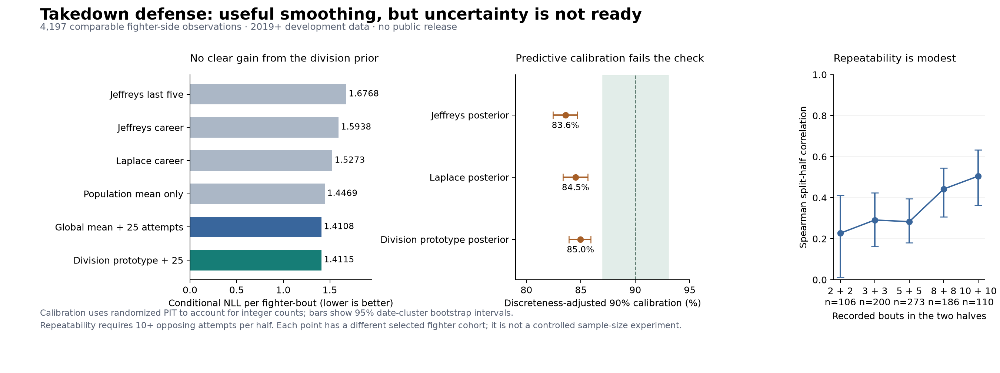

# Takedown-defense comparison and validation, October 26, 2026

**Decision: keep the site raw.** The division-specific prototype has no clear
advantage over a simpler global-mean adjustment. Its predictive distribution
also fails the uncertainty calibration diagnostics. The arithmetic passes
synthetic checks, but that does not make the real-data assumptions correct.

The new offline study is in `src/upset/skill/defense_validation.py`. Its protocol
was written before these new scores in
`docs/TAKEDOWN_DEFENSE_VALIDATION_PROTOCOL_V2.md`. Earlier 2019+ results had already
been examined; this extension is explicitly development research, not an
untouched holdout or independent preregistration. No public feature, ranking,
opponent adjustment, or protected evaluation claim was added.



## Does the prototype beat simple smoothing?

Five fixed challengers were declared. Training-period comparisons on 3,288
common-support side-bouts from 2012-2018 selected the global-mean adjustment as
the reference before looking at the new 2019+ comparisons. It uses the same
25 prior attempts as the prototype, centered on the earlier all-division mean
instead of requiring a division-specific baseline.

The development comparison uses the same 4,197 fighter-side observations,
18,876 opposing attempts and 333 date clusters as v1. Lower conditional
binomial negative log likelihood is better:

| Estimate | Mean NLL per side-bout |
| --- | ---: |
| Raw career | 3.8119 |
| Raw last five | 4.7035 |
| Career Jeffreys smoothing, +0.5 stopped / +0.5 allowed | 1.5938 |
| Career Laplace smoothing, +1 stopped / +1 allowed | 1.5273 |
| Last-five Jeffreys smoothing | 1.6768 |
| Earlier division/fallback mean alone | 1.4469 |
| Global-mean adjustment, 25 prior attempts | **1.4108** |
| Division prototype, 25 prior attempts | **1.4115** |

Prototype minus selected global reference: **+0.00069**, with a 95%
calendar-date cluster bootstrap interval **[-0.00098, +0.00237]**. There is no
clear improvement from the division-specific prior. This is not a formal
statistical equivalence test or proof that division never matters.

For the established sample (2,758 sides with 3+ earlier bouts and 10+ earlier
attempts), the difference is -0.00033, interval [-0.00204, +0.00153], again
inconclusive. Excluding both raw 0%/100% boundaries leaves 3,516 sides and a
+0.00107 difference, interval [-0.00063, +0.00290]. The secondary attempt-level
Brier score is also nearly identical: 0.22680 global versus 0.22687 division.

No sufficiently sized year/division/era/exposure group triggered the
predeclared +0.05 NLL material-regression flag. This does not establish that
all groups are safe: unknown division (65 sides) and women's featherweight
(22 sides) are explicitly inconclusive. Full subgroup results and raw-score
clipping sensitivity are retained in the JSON report.

## Are the uncertainty ranges trustworthy?

We tested plug-in binomial predictions and explicit beta-binomial posterior
predictive candidates. The latter include uncertainty in an individual's
constant probability conditional on the chosen prior. They omit uncertainty
in the estimated population baseline and prior strength, and do not model
opponent differences, time changes or within-bout dependence. These are
candidate approximations, not a complete Bayesian skill hierarchy.

Integer count intervals are conservative. For the division prototype's nominal
90% count range, observed coverage was **95.38%**, while the stated model
expected **98.12%** coverage for those discrete bounds. Comparing 95.38% directly
with 90% would therefore be misleading.

A reproducible randomized probability-integral-transform check accounts for
that discreteness. Its central nominal 90% coverage should be about 90% under
a calibrated distribution. Instead:

| Posterior predictive candidate | Adjusted 50% check | Adjusted 90% check |
| --- | ---: | ---: |
| Career Jeffreys | 42.29% | 83.58% |
| Career Laplace | 43.65% | 84.51% |
| Last-five Jeffreys | 42.34% | 82.99% |
| Division prototype | **44.10%** | **84.97%** |

For the prototype, the 90% check's 95% date-cluster interval is
**[83.91%, 85.90%]**, below the predeclared 87-93% diagnostic band. Two alternate
randomization seeds give 85.66% and 86.09%, also below the band. The 50% point
estimate falls below its 45-55% band, with a bootstrap interval of
[42.75%, 45.47%]. The 90% failure is clearer than the marginal 50% boundary.

The problem persists across both era groups: the 90% check is 85.66% in
2019-2022 and 84.29% in 2023+. The wider 5,000-positive-trial cohort, including
778 observations with no prior attempt exposure, is reported separately.
All simple plug-in and posterior candidates failed the overall calibration
bands; none is ready for public uncertainty claims.

These results indicate predictive distribution mismatch. They do not identify
one cause. Within-bout clustering, varying opponents, changing ability, source
error and an inadequate prior could each contribute. The study did not widen
intervals or tune a dispersion parameter after seeing this failure.

The predictive calculations use the official
[SciPy binomial](https://docs.scipy.org/doc/scipy/reference/generated/scipy.stats.binom.html)
and [beta-binomial](https://docs.scipy.org/doc/scipy/reference/generated/scipy.stats.betabinom.html)
implementations. They condition on actual held-out attempt counts and observed
division; they do not validate forecasts of attempts, duration or winners.

## How much history is reliable?

For each eligible fighter, compare their first M recorded bouts with their next
M. Require at least 10 opposing attempts in each half, and exclude splits that
cut through one date. No bout appears in both halves. The rate correlations are:

| Bouts per half | Eligible fighters | Spearman correlation | 95% fighter-bootstrap interval |
| --- | ---: | ---: | --- |
| 2 + 2 | 106 | 0.227 | [0.012, 0.411] |
| 3 + 3 | 200 | 0.291 | [0.163, 0.423] |
| 5 + 5 | 273 | 0.283 | [0.181, 0.395] |
| 8 + 8 | 186 | 0.442 | [0.307, 0.544] |
| 10 + 10 | 110 | 0.505 | [0.362, 0.634] |

Repeatability is modest, even in the longer-history sample. Every row uses a
different selected cohort, so this is not a controlled learning curve and does
not prove how many fights a typical newcomer needs. Only 110 of 2,670 fighters
with accepted observations meet the 10+10 primary requirements. Survivor
selection, changing opponents, time changes and division differences matter.

No universal minimum-fight threshold was established. Attrition, Pearson
correlations, positive-attempt-only sensitivity, and consistent-division slices
with at least 50 fighters are retained in the report. No consistent-division
slice met that 50-fighter minimum, so within-division repeatability remains
inconclusive. Correlation describes
repeatability, not accuracy against a known real-world latent skill.

## Synthetic recovery and verification

In 8,000 synthetic fighters drawn from a matching Beta(6,4) constant-probability
model, the 90% latent-rate interval covers the true rate **89.74%** of the time;
the predictive PIT 90% check covers **90.00%**. Mean bias is -0.00168. RMSE drops
from 0.148 with no historical attempts to 0.043 with 100 historical attempts.
The integer predictive range covers 95.66%, close to its expected 95.71% mass.
This verifies the matching mathematical implementation; it does not validate
that actual UFC bouts satisfy a constant-probability/binomial model.

The synthetic latent-rate interval is a different object from a predictive
count interval. It was tested against known latent probabilities, not against
individual observed fight results. Numerical interval calculations use
[SciPy beta](https://docs.scipy.org/doc/scipy/reference/generated/scipy.stats.beta.html).

All 17,708 frozen v1 predictions reproduced exactly. Original database, adapter,
prototype, and site-file hashes remain unchanged. Study input/output hashes,
protocol/code bindings and runtime versions (NumPy 2.5.3, SciPy 1.18.1) are saved.
The project now explicitly declares SciPy; it was already installed, so no
package installation was performed. The pre-edit project configuration is
preserved in `backups/defense-validation-20261026-160323-136159`.

35 relevant tests passed, including chronology, sufficient counts, predictive
families, discrete intervals, deterministic PIT, split boundaries, synthetic
recovery and the existing opponent-experiment regressions. Ruff and
`git diff --check` passed. The raw site and its removed-ranking state were not
changed or restarted for this study.

## Artifacts and next step

- Protocol: `docs/TAKEDOWN_DEFENSE_VALIDATION_PROTOCOL_V2.md`.
- Implementation: `src/upset/skill/defense_validation.py`.
- Complete report: `data/processed/td_defense_validation_2026_10_26_v2/report.json`.
- Extended predictions: `data/processed/td_defense_validation_2026_10_26_v2/predictions.jsonl`.
- Figure: `docs/assets/td_defense_validation_v2/validation_summary.png`.
- Verification: `data/processed/td_defense_validation_verification_2026_10_26.json`.

Existing outputs remain immutable. Reproduce with a new output name:

```bash
cd ~/Projects/upset
source .venv/bin/activate
python -m upset.skill.defense_validation \
  --adapter data/processed/td_defense_adapter_2026_10_26_v1 \
  --prototype data/processed/td_defense_prototype_2026_10_26_v1 \
  --protocol docs/TAKEDOWN_DEFENSE_VALIDATION_PROTOCOL_V2.md \
  --output data/processed/<new-validation-directory>
```

The next bounded study should use the simpler global-mean adjustment as a
reference and explicitly model bout-to-bout variability, with a declared
variance law and training-only tuning. Compare predictive distributions on
matched cohorts and families, including a global-prior posterior challenger,
then repeat calibration and reliability checks. Any iteration on these results
remains development work. A protected future evaluation and the remaining
handoff gates are still needed before release. Opponent adjustment requires a
separate model specification and has not been implemented here.
