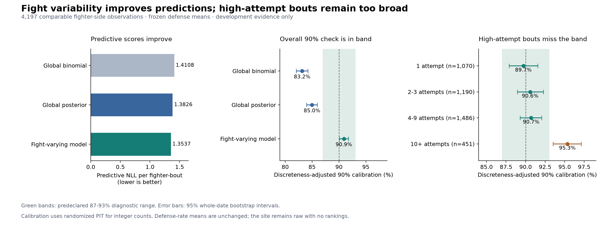

# Fight-to-fight variability study, October 26, 2026

**Result: predictive distributions improved, but the model remains offline.**
Allowing fight-to-fight variation improves predictive scores against both global
references, while preserving every defense-rate mean. Overall calibration now
falls inside the predeclared bands. The model still over-spreads outcomes for
high-attempt bouts, and several subgroup diagnostics remain outside their bands.
No public feature, ranking, opponent adjustment or skill interval was released.



## What changed

The global defense mean stays exactly as in v2: earlier career stopped attempts
plus 25 attempts centered on the earlier global population rate, divided by
earlier attempts plus 25. Three distributions use that same mean:

1. A plug-in binomial reference.
2. A stationary beta posterior predictive reference using the same global prior.
3. A bout-varying beta-binomial candidate, allowing each bout's probability to
   vary around the frozen mean.

For candidate 3, alpha=mean*kappa and beta=(1-mean)*kappa. Its count variance is
n*mean*(1-mean)*(1+(n-1)/(kappa+1)), conditional on actual opposing attempts n.
The 25 fighter-prior attempts and kappa are different parameters. Kappa is a
predictive concentration, not extra fighter history or a measured physical
correlation. No fighter latent-skill interval is constructed.

The distribution and numerical methods follow the official
[SciPy beta-binomial](https://docs.scipy.org/doc/scipy/reference/generated/scipy.stats.betabinom.html)
and [binomial](https://docs.scipy.org/doc/scipy/reference/generated/scipy.stats.binom.html)
contracts. This remains a conditional count model, not a forecast of attempts,
duration or winners. Bout variation statistically absorbs unmodeled effects;
it does not identify opponent quality or a causal source of that variation.

## Selection used training years only

The new protocol was recorded before evaluation in
`docs/TAKEDOWN_DEFENSE_VARIABILITY_PROTOCOL_V3.md`. The fixed concentration grid
was {2,5,10,20,50,100,500}. Conditional NLL on 2012-2018 selected **kappa=5**,
which was then frozen for 2019+ development results.

Training contained 3,288 comparable side-bouts across 265 dates. Of these,
2,461 had two or more opposing attempts and could inform concentration; a
single-trial beta-binomial is indistinguishable from a binomial with the same
mean. Whole-training-date bootstrap selection chose 5 in 875 of 1,000 resamples
and 10 in 125. Selection did not reach a grid edge. This selection uncertainty
is reported, not propagated into the candidate distributions.

## Predictive scores improved on matched observations

The primary comparison preserves exactly the v2 common support: 4,197 sides,
18,876 actual opposing attempts and 333 date clusters from 2019 onward. Lower
values are better for both proper distribution scores:

| Predictive family, identical mean | Mean predictive NLL | Normalized RPS |
| --- | ---: | ---: |
| Global binomial | 1.4108 | 0.17409 |
| Global stationary posterior | 1.3826 | 0.17343 |
| Global bout variability | **1.3537** | **0.17273** |

New minus binomial NLL: **-0.05713**, 95% whole-date bootstrap interval
**[-0.07278,-0.04201]**. New minus stationary posterior NLL: **-0.02894**,
interval **[-0.04119,-0.01720]**. Normalized ranked probability score also
improves against both references, with both paired intervals below zero.

This is a better predictive distribution on these development observations,
not a better defense-rate mean, winner model or opponent-adjusted skill model.
The means and their point-probability Brier scores are unchanged by construction.

The predeclared 90% interval score penalizes both range width and misses. It
improves against binomial by -0.4992 (95% interval [-0.6749,-0.3143]) and against
stationary posterior by -0.2297 ([-0.3858,-0.0740]). The 50% interval-score
comparison is inconclusive against both references. Thus the conclusion is
not based solely on making ranges wider.

## Overall calibration improves; subgroup problems remain

These are the central randomized PIT checks, which account for integer-count
discreteness. The bands are 45-55% for the nominal 50% check and 87-93% for the
nominal 90% check:

| Predictive family | 50% check | 90% check |
| --- | ---: | ---: |
| Global binomial | 42.53% | 83.15% |
| Global stationary posterior | 44.01% | 84.99% |
| Global bout variability | **52.30%** | **90.92%** |

The new 90% check has a 95% date-cluster interval of **[90.08%,91.76%]**.
Alternate randomization seeds give 91.40% and 91.80%, still inside the band.
The 50% check's interval is [50.93%,53.63%], with alternate seeds at 52.73% and
51.97%, also inside the band.

Integer 90% count ranges remain conservative because counts are discrete: the
new range covers 99.07% of observations while the model expects 98.61% mass
inside those bounds. Its average width is 3.74 stopped takedowns, compared with
2.79 for binomial. Those count-range percentages are different quantities from
the PIT checks and must not be relabeled as 90% latent-skill coverage.

Attempt-count slices expose the main remaining problem:

| Actual opposing attempts | Comparable sides | 50% PIT check | 90% PIT check |
| --- | ---: | ---: | ---: |
| 1 | 1,070 | 50.75% | 89.72% |
| 2-3 | 1,190 | 47.48% | 90.59% |
| 4-9 | 1,486 | 55.72% | 90.71% |
| 10+ | 451 | **57.43%** | **95.34%** |

For 10+ attempts, the 90% check's interval is **[93.50%,97.12%]**, wholly above
the 87-93% band. Alternate seeds remain at 96.01% and 95.57%. This is consistent
with too much predictive spread in that slice. A constant concentration makes
variance grow quadratically in attempts; that scaling deserves a separate,
training-only comparison rather than a post-hoc repair in this study.

Nine slice-by-level diagnostics miss their bands, across overlapping groups:
2019/2024 at 50%; bantamweight/light heavyweight/lightweight at 50%; 1-9 prior
attempts at 50%; 4-9 actual attempts at 50%; and 10+ actual attempts at both
levels. Some 50% misses are marginal or sensitive to the randomization seed;
they are diagnostic flags, not nine independent formal rejections. The
high-attempt 90% issue is clearer. No sufficiently sized group triggers the
predeclared material NLL-regression flag, which is a different check.
Unknown division and women's featherweight remain inconclusive because of
small samples. Full year, era, division, exposure and attempt-count diagnostics
are preserved, rather than reduced to one aggregate pass.

## Separate populations and numerical recovery

The established sample (2,758 sides with 3+ prior bouts and 10+ prior attempts)
also improves on both predictive references. The new model's 50%/90% PIT checks
are 50.40%/90.28% there.

The broader positive-trial population has 5,000 sides, including 778 with no
prior attempt exposure. Its checks are 52.20%/91.04%. The cold-start slice alone
has 51.67%/91.52%, with wider uncertainty; its 90% interval-score advantage over
the stationary posterior is inconclusive. These separate populations do not
replace the matched primary comparison. The 2,860 zero-attempt development
observations remain outside rate-calibration scoring.

A separate matching-model simulation used 8,000 bouts with known concentration
10: 4,000 for the same selection procedure and 4,000 for synthetic validation.
The grid recovered 10; synthetic held-out 50%/90% PIT checks were 48.93%/89.68%.
Analytical means and variances matched the stated beta-binomial law. This checks
implementation under known assumptions, not whether UFC data obeys them.
No latent fighter skill interval was tested or released.

## Preservation, tests and reproduction

All 17,708 v2 predictions reproduced exactly. The output extends them with bout
concentration, beta parameters, and conditional count means/variances. Every
original prediction field remains intact. The serving database, adapter,
previous study outputs, source files and website remain unchanged.

36 relevant tests passed, including frozen means, n=1 concentration invariance,
training-only selection, future-outcome isolation, numerical ties, count/shape
validation, the binomial limit, normalized RPS, interval scoring, and synthetic
recovery. Ruff and `git diff --check` passed. Independent closed-form PMF/CDF,
mean/variance and RPS audits, output hashes and the preservation checks are
recorded in `data/processed/td_defense_variability_verification_2026_10_26.json`.

- Protocol: `docs/TAKEDOWN_DEFENSE_VARIABILITY_PROTOCOL_V3.md`.
- Code: `src/upset/skill/defense_variability.py`.
- Full report: `data/processed/td_defense_variability_2026_10_26_v3/report.json`.
- Extended rows: `data/processed/td_defense_variability_2026_10_26_v3/predictions.jsonl`.
- Figure: `docs/assets/td_defense_variability_v3/variability_summary.png`.

Reproduce with a new output directory; existing outputs are immutable:

```bash
cd ~/Projects/upset
source .venv/bin/activate
python -m upset.skill.defense_variability \
  --adapter data/processed/td_defense_adapter_2026_10_26_v1 \
  --validation data/processed/td_defense_validation_2026_10_26_v2 \
  --protocol docs/TAKEDOWN_DEFENSE_VARIABILITY_PROTOCOL_V3.md \
  --output data/processed/<new-variability-directory>
```

## Decision and next bounded study

The model is a useful development challenger for predictive variability.
Overall diagnostic bands and proper-score improvement do not erase subgroup
failures, moderate repeatability, data selection, or lack of protected future
validation. Both public_release and opponent_adjusted remain false.

The next study should compare how variance scales with attempt count while
keeping this mean model and the constant-concentration reference frozen. Declare
the alternative variance law and training-only selection before evaluating it.
Do not tune it to hit the inspected subgroup bands. Opponent adjustment still
needs a separate specification; these results are not evidence that it has
already been modeled. Mean/hyperparameter uncertainty and longitudinal fighter
dependence also remain limits of this study.
